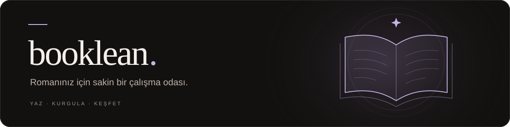
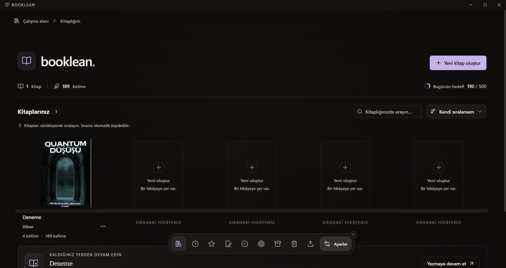
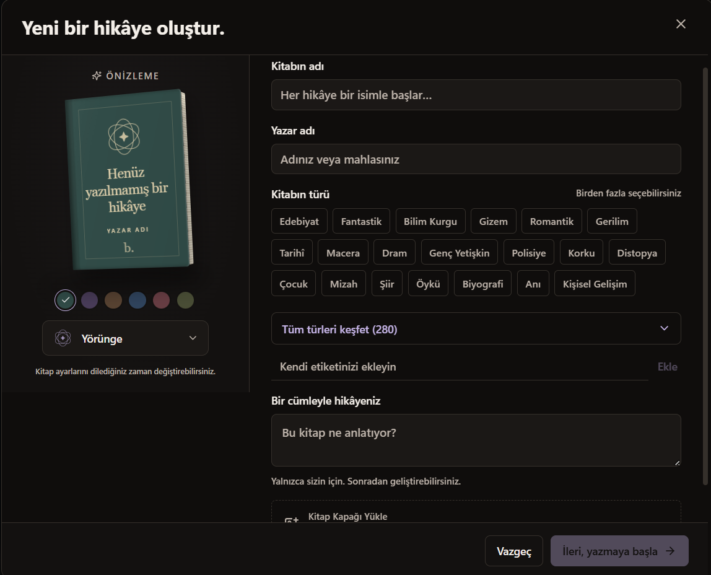
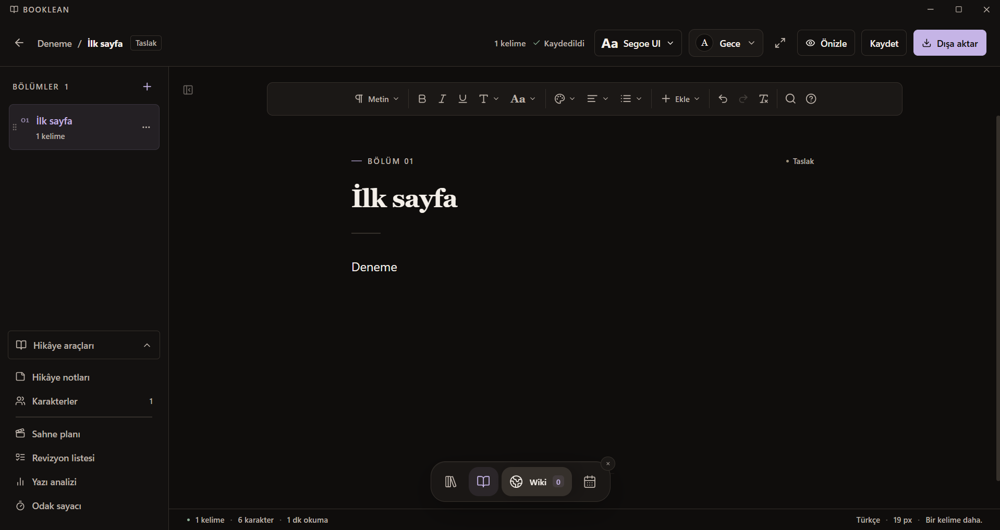
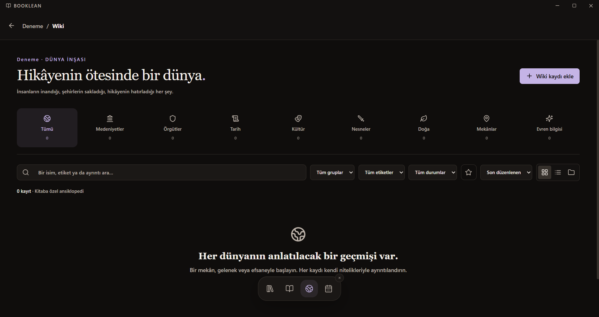
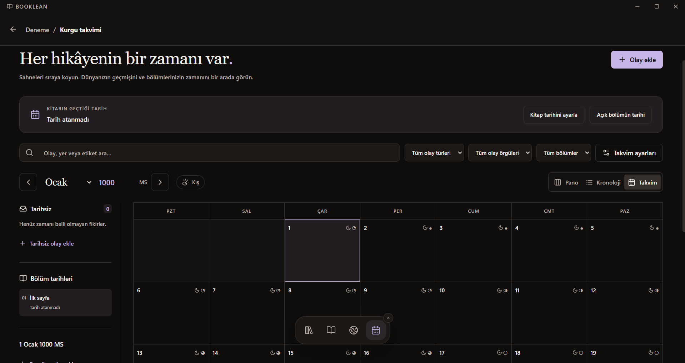
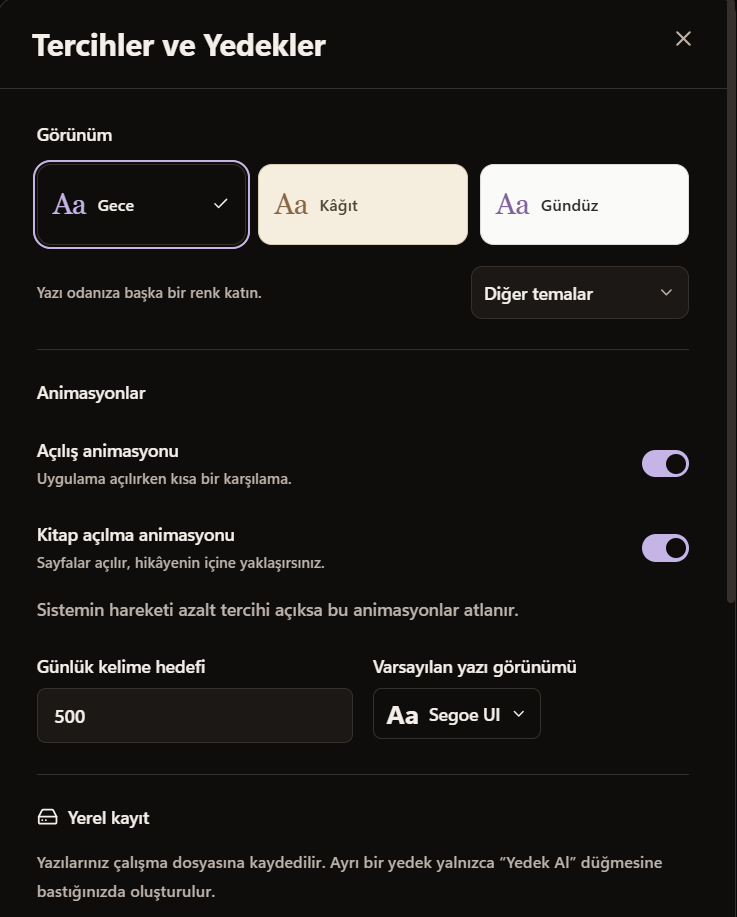
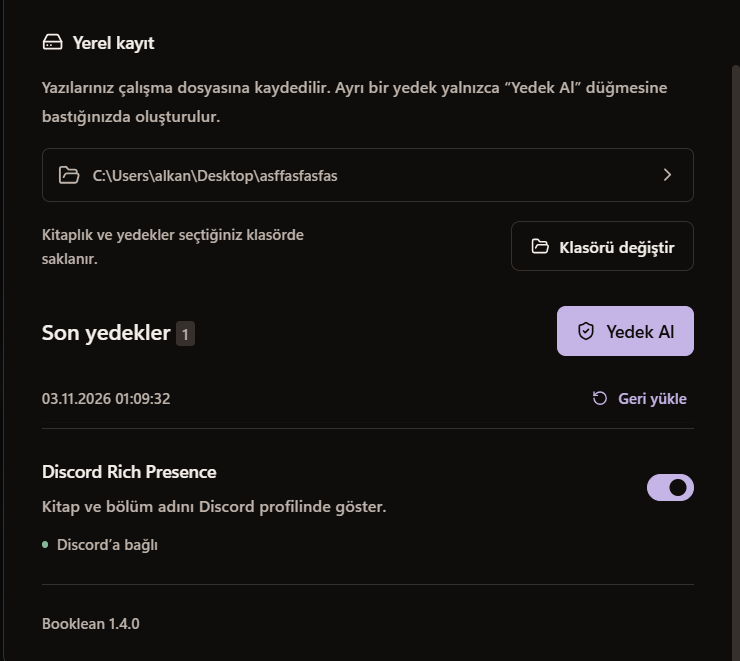

<p align="center">
  
</p>

<p align="center">
  <strong>Hikâyenizi yazın. Dünyanızı kurun. Kendi ritminizde ilerleyin.</strong>
</p>

<p align="center">
  Türkçe arayüz · Windows x64 · Yerel kayıt · Kurulumsuz kullanım
</p>

<p align="center">
  <a href="#başlangıç">Başlangıç</a> ·
  <a href="#yazı-odanız">Özellikler</a> ·
  <a href="#ekran-görüntüleri">Ekran görüntüleri</a> ·
  <a href="#dosya-aktarımı">Dosya aktarımı</a> ·
  <a href=".github/SUPPORT.md">Destek</a> ·
  <a href=".github/CONTRIBUTING.md">Katkıda bulun</a>
</p>

---

**Booklean**, romanlarınızı ve uzun metinlerinizi tek bir yerde düzenleyebileceğiniz bir masaüstü yazı uygulamasıdır. Bölümler, karakterler, notlar, birbiriyle bağlantılı Wiki kayıtları ve kurgu takvimi aynı çalışma alanında buluşur. Yazmak için hesap açmanız veya internete bağlanmanız gerekmez.

## Başlangıç

### Hazır uygulama ile

`Booklean-…-portable.exe` dosyasını açın. Kurulum gerekmez; uygulamayı istediğiniz klasörden çalıştırabilirsiniz. Kaynaktan üretilen paketler `release/` klasörüne yazılır.

1. **Yeni kitap oluştur** ile kitabınızın adını, yazarını ve kapağını belirleyin.
2. İlk bölümünüzü yazmaya başlayın. Yeni bölümleri soldaki **+** ile ekleyin.
3. **Hikâye araçları** ile notlarınızı, karakterlerinizi ve sahnelerinizi düzenleyin.
4. Çalışmanızı paylaşmak için **Dışa aktar** seçeneğini kullanın.

İlk açılışta boş bir kitaplıkla başlayın ve kendi kitabınızı oluşturun. Alttaki dinamik ada, kitaplık ile yazı odası, Wiki ve kurgu takvimi arasında geçiş sağlar.

### Kaynaktan çalıştırmak için

Windows üzerinde **Node.js 22.12 veya üzeri bir 22.x sürümü** ve Git gerekir.

```powershell
git clone https://github.com/ArviiSoft/booklean.git
cd booklean
npm ci
npm run dev
```

Portable EXE üretmek için `npm run dist` çalıştırın veya `EXE-OLUSTUR.cmd` dosyasını açın. Geliştirme ortamı kendi kitaplığını kullanır. Geliştirme ve paketleme ayrıntıları [katkı rehberindedir](.github/CONTRIBUTING.md). Derlenmiş paketler, yerel kitaplıklar ve yedekler kaynak kod deposuna dahil edilmez.

## Yazı odanız

| Alan | Neler yapabilirsiniz? |
| :--- | :--- |
| **Kitaplık** | Kitapları raflarda görün; sürükleyerek sıralayın, arayın, favorilere ekleyin veya arşivleyin. |
| **Editör** | Başlıklar, listeler, renkler, dipnotlar, bağlantılar ve görsellerle metninizi düzenleyin. Bul/değiştir ve odak modunu kullanın. |
| **Hikâye araçları** | Karakter kartları oluşturun; sahneleri planlayın, revizyonları takip edin, yazınızı analiz edin ve odak oturumları başlatın. |
| **Wiki** | Mekânları, toplulukları, nesneleri ve evren bilgilerini kaydedin; kayıtları karakterlere, bölümlere ve birbirlerine bağlayın. |
| **Kurgu takvimi** | Olayları tarih, kronoloji veya pano üzerinde düzenleyin. Hikâyenize özel aylar, haftalar ve mevsimler tanımlayın. |
| **Görünüm** | 11 tema, 15 kapak deseni ve 12 yazı tipi arasından seçin. Yazı boyutunu, satır aralığını ve animasyonları ayarlayın. |

<details>
<summary><strong>Çalışma alanını kendinize göre düzenleyin</strong></summary>

- Ayarlar’da **Gece**, **Kâğıt** ve **Gündüz** temaları hemen görünür; diğer seçenekler **Diğer temalar** menüsündedir.
- Editörün üstündeki tema menüsü okurken ve yazarken kullanılabilir. **Yazı görünümü** okuma tercihini, biçimlendirme çubuğundaki **Aa** seçili metni değiştirir.
- Açılış ve kitap açılma animasyonları ayrı ayrı kapatılabilir; sistemin hareketi azalt tercihi de dikkate alınır.
- Kitapların ve bölümlerin üç nokta menülerindeki taşıma seçenekleri, sürüklemeye alternatif sunar.

</details>

## Ekran görüntüleri

### Kitaplık

Kitaplarınız, günlük kelime hedefiniz ve kaldığınız yerden devam etme seçenekleri tek bir rafta.



### Yeni bir hikâye

Kitabınızın adını, yazarını, türlerini ve kapak görünümünü belirleyerek başlayın.



### Yazı odası

Bölümlerinizi düzenleyin; biçimlendirme çubuğuna ve hikâye araçlarına yazarken ulaşın.



### Wiki ve dünya inşası

Hikâyenizin mekânlarını, kültürlerini, tarihini ve evren bilgilerini bir araya getirin.



### Kurgu takvimi

Olayları ve bölüm tarihlerini takvim, kronoloji veya pano görünümünde takip edin.



### Tercihler ve yedekler

Görünümü ve yazı hedefinizi ayarlayın; yerel kayıt, yedekleme ve Discord bağlantısını yönetin.

<table>
  <tr>
    <th scope="col">Görünüm ve yazı tercihleri</th>
    <th scope="col">Yerel kayıt, yedekler ve Discord</th>
  </tr>
  <tr>
    <td width="50%" valign="top"></td>
    <td width="50%" valign="top"></td>
  </tr>
</table>

## Dosya aktarımı

Kitabın tamamını veya yalnızca seçtiğiniz bölümü dışa aktarabilirsiniz.

| Amaç | Biçimler |
| :--- | :--- |
| **Tam proje taşımak** | `.booklean` — kapak, bölümler, karakterler, notlar, Wiki, takvim ve yazarlık araçları |
| **Okumak ve paylaşmak** | `.pdf`, `.docx`, `.epub` |
| **Metinle çalışmak** | `.txt`, `.md`, `.html`, `.csv`, `.odt`, `.rtf` |

Bu biçimler içe aktarımda da desteklenir. İçe aktarımın kapsamı biçime göre değişir; örneğin PDF’den metin katmanı alınır. Karmaşık sayfa düzenleri bire bir korunmayabilir. Tarama/OCR, şifreli belgeler ve eski `.doc` dosyaları desteklenmez. [Ayrıntılı aktarım rehberi →](.github/SUPPORT.md#dosya-aktarımı)

## Yazılarınız ve yedekleriniz

Yazılarınız bilgisayarınızda saklanır ve değişiklikler otomatik kaydedilir. Normal uygulama `%APPDATA%/Booklean`, geliştirme ortamı `%APPDATA%/Booklean-dev` klasörünü kullanır. Kayıt konumunu **Ayarlar → Yerel kayıt** bölümünden değiştirebilirsiniz.

> **Otomatik kayıt ile yedek farklıdır.** Ayrı bir yedek oluşturmak için **Ayarlar → Yedek Al** düğmesini kullanın. Yedeği geri yüklemek tüm kitaplığı seçtiğiniz tarihe döndürür.

Portable EXE, kitaplığınızı yanında taşımaz. Başka bir bilgisayara geçerken `.booklean` dosyalarını veya veri klasörünüzün bir kopyasını kullanın.

İsteğe bağlı **Discord Rich Presence**, Discord masaüstü uygulamasında kitap ve bölüm adını gösterebilir. Metnin içeriği paylaşılmaz. Bu özellik varsayılan olarak açıktır ve Ayarlar’dan kapatılabilir.

## Klavye kısayolları

| Kısayol | İşlem | Kısayol | İşlem |
| :--- | :--- | :--- | :--- |
| `Ctrl+S` | Kaydet | `Ctrl+F` | Bul ve değiştir |
| `Ctrl+B` | Kalın | `Ctrl+I` | İtalik |
| `Ctrl+U` | Altı çizili | `Ctrl+Z` | Geri al |
| `Ctrl+Shift+Z` | Yinele | `Esc` | Açık menüden, pencereden veya odak modundan çık |

---

<p align="center">
  <a href="https://github.com/ArviiSoft/booklean/issues/new/choose">Hata bildir / fikir öner</a> ·
  <a href=".github/CONTRIBUTING.md">Katkı rehberi</a> ·
  <a href=".github/SECURITY.md">Güvenlik</a> ·
  <a href=".github/CODE_OF_CONDUCT.md">Topluluk kuralları</a>
</p>

<p align="center"><sub>Bir kelime daha.</sub></p>
